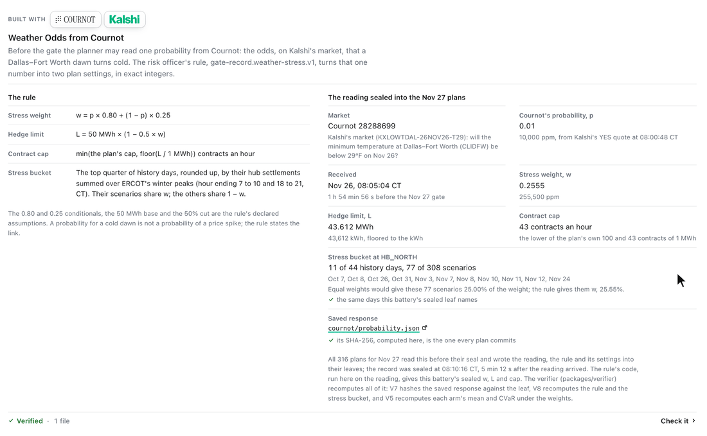
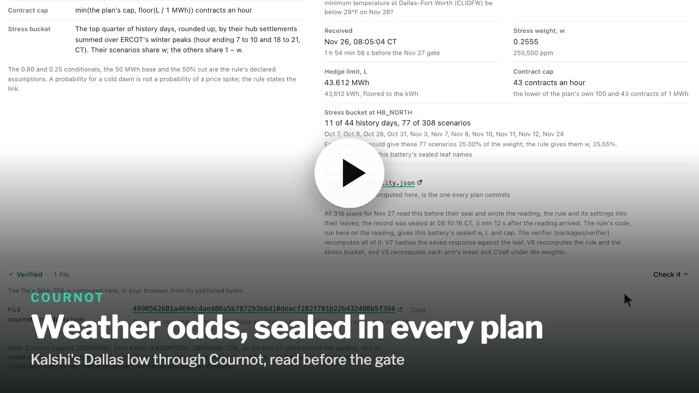

# Cournot Integration

<p align="center"></p>

<!-- VIDEO-TODO(cournot): replace the link below with the film's YouTube URL. -->
<!-- FILM-LINK-PENDING <a href="https://youtu.be/VIDEO-TODO-cournot"></a> -->

Cournot's Intelligence Oracle gives the planner one outside view before the market's gate: the odds, from Kalshi's market, that the Dallas–Fort Worth low falls below 29°F. Wattness's declared rule turns that probability into the weight on each battery's stress scenarios and the hourly hedge cap, and the response's SHA-256 is sealed in every Nov 27 plan on BSC mainnet. Code: [`packages/adapters/cournot`](../../packages/adapters/cournot) and the rule, [`packages/core/src/weather.ts`](../../packages/core/src/weather.ts).

## 1. The project

Wattness Grand Prix plans tomorrow for every ERCOT battery with complete public data (316 on Nov 26) and seals the plans on BNB Chain before ERCOT's 10:00 CT day-ahead gate: one root, one transaction, and a contract that refuses a late or a second record. Anyone can then check any battery's plan against the chain. Cournot is the plan's one view of the weather, read before the gate and sealed with the plan, so it can never be chosen after the fact.

## 2. Where and how it calls Cournot

- **Where.** Inside the plan run, before the seal. The risk officer reads the probability; the planner uses it. One command plans the fleet with one live call:

  ```sh
  pnpm plan --od 2026-11-27 --fleet --cournot live --cournot-resolve <saved-resolve.json> --cournot-market <id>
  ```

- **How.** First the event is resolved, one call to `POST https://interface.cournot.ai/intelligence/v1/resolve`, and the response is saved (`node packages/adapters/cournot/dist/live.js resolve "<event description>"`). The plan run checks the chosen market against the rule, then makes one call to `POST https://interface.cournot.ai/intelligence/v1/probability` for that market only, with a 20-second limit. Requests are never retried automatically, so a call is never spent twice.
- **The official Skill.** These are the endpoints the official Cournot Intelligence Oracle Skill calls, in its order: resolve, then probability. In [Cournot-AI/cournot-skills](https://github.com/Cournot-AI/cournot-skills), the Skill, `cournot`, documents the flow in `skills/cournot/references/query-flow.md` and the response in `skills/cournot/references/response-format.md`, and builds the request path `/intelligence/v1/<operation>` in `skills/cournot/scripts/account-flow.mjs`. The adapter makes the same two calls from this repository's MIT TypeScript, and the Skill itself made a live call too (section 5).
- **What the rule reads.** A Kalshi lower-tail minimum-temperature market at Dallas–Fort Worth (station CLIDFW), for the operating day or the day before it. The claim (market ID, station, threshold and date) is read from the market's title and rules text, which must agree. The reading must arrive before the plan time and the gate, and at most 24 hours before the plan time.
- **When it cannot be used.** If the market is not one the rule reads, the call fails, or the response cannot be read, the plan goes ahead without it and records `status: "not_applied"` with the reason; the scenarios stay equally weighted, and the seal never waits.
- **Handling.** An HTTP 200 with a nonzero API code is not a success; a probability must be finite and within [0, 1]; the response must name the selected market and no other; HTTP 402 stops without paying and 429 is reported as rate limiting; redirects are refused; keys, IP fields and email addresses are removed from what is saved.

## 3. How it uses the probability

The rule is `gate-record.weather-stress.v1`, and its parameters are written into every plan that reads Cournot.

- **The stress scenarios.** From each battery's own scenario matrix, each history day is scored by its scenarios' hub settlements summed over ERCOT's winter peaks (hour ending 7 to 10 and 18 to 21, Central). The top quarter of history days, rounded up, are the stress days, and every scenario built on one is in the stress bucket: the days when real time ran furthest above forecast at those peaks.
- **The weights.** The bucket carries w = p × 0.80 + (1 − p) × 0.25 of the probability; the other scenarios share 1 − w, equally within each group.
- **The hedge limit.** L = 50 MWh × (1 − 0.50 × w), floored to the kWh. The hourly contract cap is the lower of the plan's own cap and L in whole contracts.
- **The decision it drives.** The weights carry into the fair-value hedge entry, the mean and the CVaR, by which the planner scores the three choices for each battery and picks one. On Nov 27, p = 0.01 moved the stress weight from 25% (equal weights) to 25.55% and the hedge cap from 100 contracts an hour to 43, on all 316 plans. At the rule's prior, p = 0.30, the weight would have been 41.5% and the cap 39.

**What is Cournot's and what is ours.** Cournot returns the probability, the matched market (its title, rules, end time and outcome price), the matching confidence and the basis (source, summary, time and link). Ours, and labeled as ours wherever they appear: the 0.80 and 0.25 conditionals, the 50 MWh base, the 50% cut, the stress bucket, and the link from a cold dawn to price stress. A probability of a cold dawn is not a probability of a price spike; the rule states the link and owns it.

## 4. Where users see the claim and the evidence

- **The Forecast tab.** The [Forecast tab](https://gp.wattness.tech/agents/forecast)'s "Weather Odds from Cournot" card shows the rule beside the reading sealed into every Nov 27 plan (Cournot market 28288699, received 08:05:04 CT on Nov 26): the exact claim (market, station, threshold and date), Cournot's probability, its basis (Kalshi's YES quote and its time), when it was received, the stress weight, the hedge limit and the contract cap, and the battery's own stress days. The rule's assumptions are labeled there as ours.
- **Every Nov 27 plan.** Each of the 316 plans carries, under `outside_inputs.cournot`: the rule and its parameters, the claim, p in parts per million, Cournot's basis as returned, the receipt time, the response's route and SHA-256, the stress days, and the stress weight and hedge cap before and after.
- **The response itself.** Published beside the record on BNB Greenfield, at `od-20261127/cournot/probability.json` in the bucket `wattness-grand-prix-records`.

## 5. Proof of a successful call

**Nov 27's call, sealed on BSC mainnet.**

| | |
|---|---|
| Requested | Nov 26, 08:05:03 CT (21:05:03 Bangkok) |
| Answer | HTTP 200, code 0, `"Success"` |
| Claim | Cournot market 28288699, Kalshi's KXLOWTDAL-26NOV26-T29: "Will the minimum temperature be <29° on Nov 26, 2026? (Yes: 28° or below)", Dallas (CLIDFW) |
| Probability | 0.01 |
| Basis | Kalshi's latest YES price, 0.0100, at 08:00:48 CT |
| Received | 08:05:04 CT, rounded up to the second: 42 s before the plan time, 08:05:46 CT |
| Response SHA-256 | `4990562681a469dc4ae486a5b787293b6d10deacf282f701b22b432488b5f394` |
| Sealed in | every one of the 316 Nov 27 plans, under root `0x3cd800432f3596e13c9f169348630c0fb69192501cf448a4859dd3104e9e59be` |
| On chain | BSC mainnet, [0xd6ce6ebd…f853dbef](https://bscscan.com/tx/0xd6ce6ebdd4f70dfe3aafae5fb76f014152f10a9f3a6c83d52362954cf853dbef), 08:10:41 CT, 1 h 49 min before the gate |

The API returns no request ID, so the sealed hash is the reproducible proof. Download the saved response (the caller's IP removed) and hash it:

```sh
curl -s https://gnfd-testnet-sp3.nodereal.io/view/wattness-grand-prix-records/od-20261127/cournot/probability.json | shasum -a 256
```

The hash matches `outside_inputs.cournot.response.sha256` in any Nov 27 plan, and that plan's proof leads to the root on chain. The verifier does the same: its input check (V7) hashes the published response and compares its claim, probability, basis and time with the plan's, and its shape and rule check (V8) recomputes the weights, the hedge cap and the stress bucket from it.

**Through the official Skill itself.** On Nov 26 at 09:31:18 CT the Skill, `cournot`, resolved the same Kalshi market (Cournot market 25380188) and asked its probability. Cournot answered HTTP 200, `"Success"`, p = 0.01, with Kalshi's YES price, 0.0100 at 09:30:51 CT, as its basis. <!-- R3: link evidence/cournot/official-skill/probability-od26m-20261126T153118Z.json here once it is published. -->

**The earlier live call.** On Nov 25, for the same Kalshi market, KXLOWTDAL-26NOV26-T29 (Cournot market 24962617), Cournot returned p = 0.01, received 8 min 16 s before the Nov 26 gate, the day before the reading the Nov 27 plans sealed.

## Setup

From the repository root:

```sh
pnpm install
pnpm --filter @gatelock/core build
pnpm --filter @gatelock/cournot build
pnpm --filter @gatelock/cournot test
```

Anonymous access needs no key. A prepaid key is read on the server only, as `COURNOT_API_KEY`; the package's index is safe for a browser bundle. More in [the adapter's README](../../packages/adapters/cournot/README.md).
