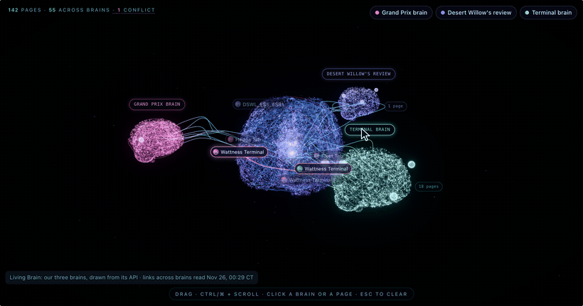
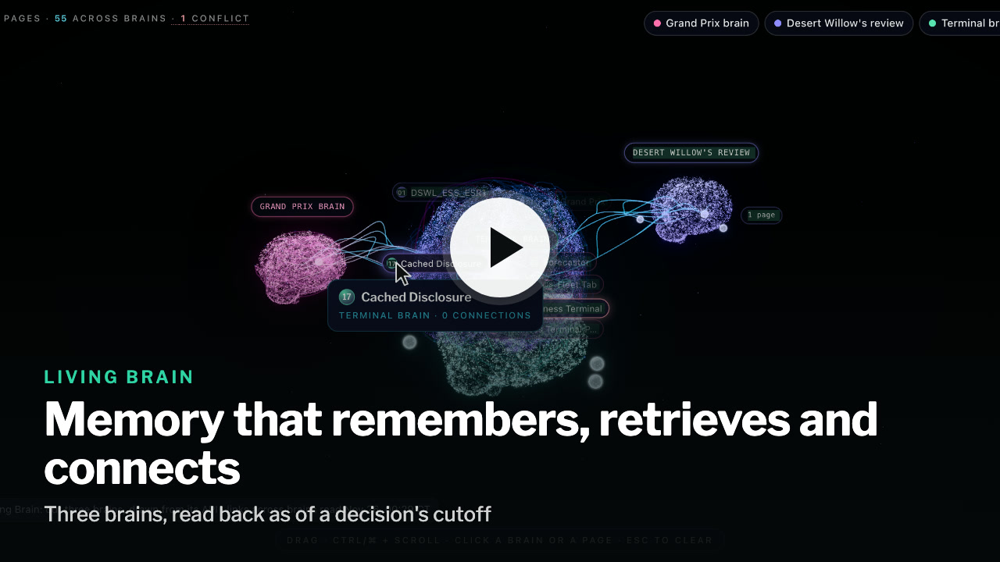

# Living Brain: agents that remember their reviews, as of the decision

<p align="center"></p>

<a href="https://youtu.be/KLQ_pEghhjw"></a>

Living Brain is the agents' persistent memory, used through its REST API. Desert Willow (DSWL_ESS_ESR1), the showcase battery, has a brain of its own for the reviews of its plans; the build and the Wattness Terminal each have one too. Code: [`packages/adapters/living-brain`](../../packages/adapters/living-brain). Interface: the [Memory tab](https://gp.wattness.tech/agents/memory).

## The problem

The agents plan every ERCOT battery with complete public data (316 on Nov 26) before the day-ahead gate, and a sealed plan is reviewed after it. Without memory, each review starts from nothing and repeats the last one's questions. With ordinary memory there is a worse failure: a review of a plan can lean on something learned after that plan was sealed, and a record that leans on hindsight cannot be audited. Memory for plans sealed before a market's gate has to keep the same clock: what was known by a decision's cutoff, and nothing after it.

## The solution

- **Remember.** A reviewed lesson is captured to the battery's brain with an origin reference built from the battery, the sealed root and the note's version. The runner records the captured source IDs, so a rerun reads the same sources instead of capturing again, and it waits for Living Brain to compile the capture.
- **Retrieve.** A fresh session, which knows only the lesson's public origin reference and never its text, searches the brain and reads full pages back as of a cutoff (`retrieveAt`). It admits only pages whose current content and every source were available by the cutoff. It excludes contested, stale, archived and deprecated pages, pages edited after the cutoff, pages with unknown provenance, and sources from another brain. Each page it uses is cited by slug, version, source IDs and the time it became available.
- **Connect.** Living Brain links pages within a brain and across brains, each connection with its similarity score and reasoning. The Memory tab shows three brains: the build's own, from the site's tabs to GateRecord and the checks (123 pages, 276 connections, from 34 notes); the Wattness Terminal's (18 pages, 53 connections); and Desert Willow's review brain. Together they hold 142 pages, with 55 connections across brains.
- **A better second interaction.** In the live run (Nov 25, 10:58 CT / 23:58 Bangkok), the first session captured two notes for Desert Willow (DSWL_ESS_ESR1): the sealed plan's context and the reviewed rule for its hedge, that the entry is assumed at the model's fair value, so the result is a scenario comparison and not a trade. A fresh client retrieved page `dswl-ess-esr1`, version 2, and cited it. Its review of the hedge moved from "needs-supported-review" to "assumed-entry-scenario".
- **The cutoff holds.** Asked as of the Nov 26 plan's own time, the same retrieval admitted no page: the lesson was written after that plan was sealed.

## What makes it unique

- **Memory that keeps the gate's clock.** Retrieval takes a cutoff and refuses anything that did not exist by then, so a review as of the seal time cannot use hindsight.
- **Citations, not snippets.** A review cites page, version and sources; search snippets stay internal and never enter a review.
- **One brain per asset.** Each battery's lessons stay in its own brain, and a source from another brain is refused.
- **Beside the sealed plan, never inside it.** Memory is read after the seal: it improves the review without changing what was committed on chain.
- **The build remembers itself.** A brain on the build itself, 123 pages from the site's tabs to GateRecord and the checks, read back on the Memory tab beside the Terminal's.

## How the agent uses Living Brain

| Method | Operation |
|---|---|
| `POST /v1/brains` | Create an isolated brain for one battery |
| `POST /v1/brains/{brainId}/captures` | Capture a reviewed note with its required origin reference |
| `GET /v1/brains/{brainId}/sources?ids=...` | Poll the exact source until it is compiled |
| `POST /v1/brains/{brainId}/search` | Find candidate pages |
| `GET /v1/brains/{brainId}/pages/{slug}` | Read a page's full content and provenance |
| `GET /v1/brains/{brainId}/graph` | Read pages and connections for the Memory tab |

The API key and subject ID are read on the server only and sent only to Living Brain's API origin; neither reaches a browser or an evidence file. Network failures are never replayed automatically, and polling is bounded.

## Run it

From the repository root:

```sh
pnpm install
pnpm --filter @gatelock/core build
pnpm --filter @gatelock/living-brain build
pnpm --filter @gatelock/living-brain test
pnpm --filter @gatelock/living-brain live   # reads LIVING_BRAIN_API_KEY and LIVING_BRAIN_SUBJECT_ID from the env file GATE_SECRETS_ENV names
```
