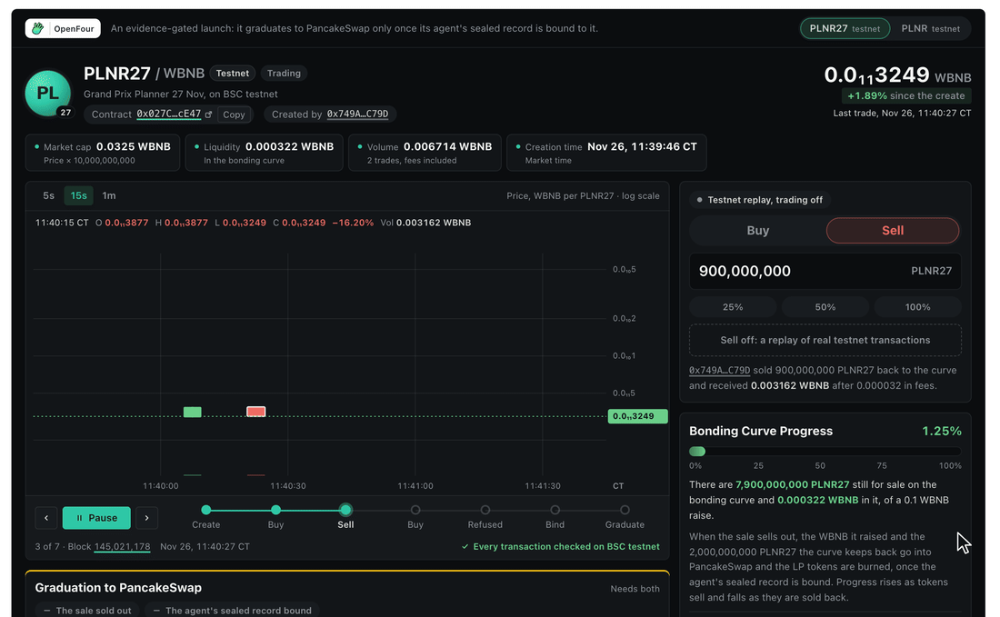
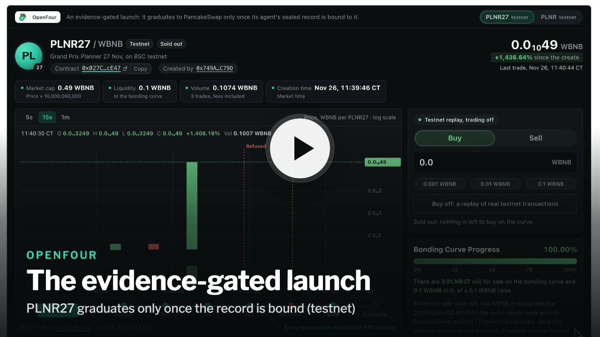

# OpenFour: no sealed record, no graduation

<p align="center"></p>

<!-- VIDEO-TODO(openfour): replace the link below with the film's YouTube URL. -->
<a href="https://youtu.be/MKUSWZ3LxvQ"></a>

Route: **OpenFour Hub**, a new launch mechanism. Preset: **Evidence-gated Bonding V1** (preset `1795634196178`).

OpenFour, Four.meme's open launch framework, builds each launch from swappable modules. Evidence-gated Bonding V1 keeps Bonding V1's Token, Vault, Curve and Trade and replaces Migrate, so an agent's token graduates only once the agent's own sealed record is bound to it. It runs on our own deployment of OpenFour on BSC testnet, made with OpenFour's fork-deploy toolkit, and the agent token, PLNR, is a testnet placeholder.

Code: [`modules/openfour`](../../modules/openfour). Interface: the [Launchpad tab](https://gp.wattness.tech/markets/launchpad), which reads the launch with view calls.

## How the mechanism works

`EvidenceGatedMigrateModule` (tag `module.migrate.evidence_gated`) graduates a launch only when both conditions hold at the moment the migration runs:

1. **Liquidity.** The vault's own predicate, read from the vault: sold out, or raised at least a quote floor.
2. **Evidence.** A GateRecord record bound to this launch with `bindEvidence(od, root)`, by the agent or the token's creator, and found by `keyOf(agent, scope, od)`. Its committer, scope, day and root must match; it must cover at least the launch's `minLeafCount` batteries; it must have been committed before that day's gate; and, when the launch sets them, its code hash must match and a settlement outcome must be linked.

`graduate()` asks Core to migrate now and reverts with the missing condition (`LiquidityNotReady`, `EvidenceMissing`, `EvidenceRootMismatch`, and so on). Outside `graduate()` the module answers false until both conditions hold, so a missing record never reverts the buy that sells out the sale. Graduation moves the vault's remaining tokens and its raised quote into an empty PancakeSwap V2 pair and mints the LP to `0x…dEaD`. The GateRecord address and the V2 factory are constructor arguments of the implementation, so a launch cannot point the gate at another record source.

## The user problem

On a launchpad, a token graduates when its sale sells out: demand alone lists it. When the token belongs to an agent, the people buying it have no on-chain way to tell whether the agent does the work it claims before the token lists.

## The intended audience

People who buy into AI agents' launches and want graduation to mean the agent has a record; agent builders who want their launch to carry proof of work; launchpads that want a preset in which listing waits for evidence.

## What makes it different

- **Graduation reads the agent's own record.** The record is found by a key derived from the agent's address, scope and day, so only that agent's sealed record satisfies it. A root on its own never qualifies.
- **The evidence is bound in time.** The record must have been committed before the market's gate, which GateRecord computes itself, so it cannot be produced after the prices are known.
- **One module changes; the rest stays standard.** Token, Vault, Curve and Trade are Bonding V1's, so buying, selling and the curve work as users already know.
- **Every condition is readable before it matters.** The launch tower names what is missing, liquidity or evidence, with view calls only.

## On BSC testnet (chain 97)

| | Address |
|---|---|
| Registry (our deployment) | `0x4458EdB563886b1568701A13aDFb0D3e17254e99` |
| Core | `0x90feAb906d1eE89611576DD6F042Bca840A94aF7` |
| Tools | `0x4a60f097A2f39a007bd92737B6c80aEE30992072` |
| Evidence-gated Migrate implementation | `0xfc2E00dCfC39C71F97Ce0e6ba9C52717Ed8fbA8e` (beacon `0xd57B39899b3bb33d85ACAAe705d571a1559F30C6`) |
| Preset | `1795634196178`, Evidence-gated Bonding V1 |
| PLNR, the agent token (testnet placeholder) | `0xB1e792b2C6Bf7Ae7A1D972af313442039422ef14`, migrate instance `0xD23E368C50b8F5E8624Adfc30cdE2D4dE8E87735` |
| PLNR / WBNB pair (PancakeSwap V2, testnet) | `0xe54cDdE2d4A28b0131C5Dc6b9E5Afb20701680Ee` |
| GateRecord | `0x2922c68cE15EB3e83B7f43b136e981dDc4262876` |

| What | Transaction | When (CT) |
|---|---|---|
| Module implementation deployed | [`0x1cd5fca5…`](https://testnet.bscscan.com/tx/0x1cd5fca52f8af590effedca8e6d3682e1b3424626f2bcd03a2312a8e7be74e45) | Nov 25 |
| Preset Evidence-gated Bonding V1 added | [`0x23aa595a…`](https://testnet.bscscan.com/tx/0x23aa595add67656eb2965908309467b1d4d2f35ade1a50f0dbbf39095e32a7f2) | Nov 25 |
| Launch created (needs this agent, at least 300 batteries, a day from Nov 26, the Nov 26 code tree) | [`0x87537227…`](https://testnet.bscscan.com/tx/0x875372271c9dde0ecdb3703dec11a7fd88108d68ce80bde84241ab4411ecac6f) | Nov 25 |
| Graduation refused with `EvidenceMissing`, the sale sold out | [`0x219f25a2…`](https://testnet.bscscan.com/tx/0x219f25a2b86a8a73595911f40dd81f072655bd6711fdd4eb6b8108b6a733686e) | Nov 25, 13:17:22 |
| The Nov 26 record bound | [`0xd100cfa2…`](https://testnet.bscscan.com/tx/0xd100cfa2402baaeec7de4545deedec2f72d238bbb53ec3fc34753d93718a1128) | Nov 25, 13:17:40 |
| Graduated into the PancakeSwap V2 pair | [`0xc549f6e5…`](https://testnet.bscscan.com/tx/0xc549f6e5a6598ba308e6ecb837cf0da2a6fa23c1d72a6e40065df4c585af5330) | Nov 25, 13:17:51 |

### The second launch, Nov 27: create, buy, sell, migrate

Grand Prix Planner 27 Nov (PLNR27, testnet placeholder) `0x027C1A8D15ceb3048F5EC787D5e1E64B1043cE47`, on the same module and preset, graduated into the PancakeSwap V2 pair `0x28Fb374c51B89c7D58c5849a478339BFda640879` once the Nov 27 sealed record was bound. Times are CT on Nov 26.

| What | Transaction | When (CT) |
|---|---|---|
| Launch created | [`0x26ab9fbc…`](https://testnet.bscscan.com/tx/0x26ab9fbc2def498e98436ee1754700eaddcd5c6d3a3ea54a83a7e9562d546323) | 11:39:46 |
| Bought 1 billion | [`0x65bd6eba…`](https://testnet.bscscan.com/tx/0x65bd6eba352db36dd2054f307330352fca71ce4468e8fc8778f9d21b3f2268b5) | 11:40:11 |
| Sold 900 million back to the curve | [`0x1e420c74…`](https://testnet.bscscan.com/tx/0x1e420c74807f518ea5a7ce5831add11c13b51a0d4cd06b20c6cc3eeb62f6fd56) | 11:40:27 |
| Bought to sell-out | [`0xdd809ed5…`](https://testnet.bscscan.com/tx/0xdd809ed51df954bd0e3f4aa931650ac6a187f20072cfeb22ee05ecd8224d9467) | 11:40:44 |
| Graduation refused with `EvidenceMissing` | [`0xce84183e…`](https://testnet.bscscan.com/tx/0xce84183e3eba32a691dd66dad351c1eba0541df7d64c46a7471cfe222891eeaf) | 11:40:58 |
| The Nov 27 record bound | [`0xd7be1172…`](https://testnet.bscscan.com/tx/0xd7be1172ffe756dc26175c9b6520fcdfe41d85a7b190cd571bffa851ed10d515) | 11:41:17 |
| Graduated into the PancakeSwap V2 pair | [`0x9d2b5112…`](https://testnet.bscscan.com/tx/0x9d2b5112d35700f4fe274fcc70dc537ddfb9755d4f891d4e4e26d7ee133b6720) | 11:41:28 |

Every create, buy, sell and migrate of both launches is in [`modules/openfour/submission/tokens.json`](../../modules/openfour/submission/tokens.json). The gameplay proposal (description, composition, risk notes) is [openfour-gameplay.md](openfour-gameplay.md), and the AI-assisted audit of the module and its preset wiring is [openfour-ai-audit.md](openfour-ai-audit.md).

## Build and test

From the repository root:

```sh
pnpm --filter @gatelock/openfour build
pnpm --filter @gatelock/openfour test
```

The contracts compile with Hardhat; the tests run on Hardhat's in-process chain against the real GateRecord. `modules/openfour/scripts/launch.ts` deploys the module and preset, creates a launch and runs the refused and the granted graduation ([its README](../../modules/openfour/README.md)).
